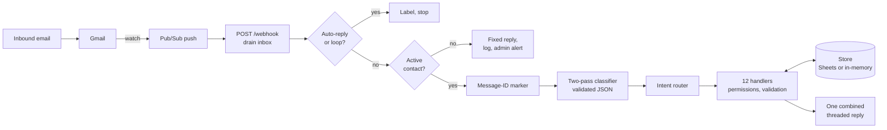

# llm-message-gateway

An email-driven task coordinator in which an LLM classifies what each message asks for and Python enforces every rule. Staff assign, update, extend and close work by writing ordinary emails, in English or Arabic; the system keeps one shared task record in a spreadsheet and answers every message.

This repository is a **showcase extract** of a backend I wrote for a client. It keeps the engineering: the channel abstraction, the Gmail adapter, the security gate, the two-pass classifier, the intent router and handlers, the store and the tests. Business detail is removed. Anything left out on purpose is marked **[Redacted]**, in the code and in [Not included](#not-included).

## Architecture



1. Gmail publishes a notification to Pub/Sub, which pushes to `/webhook`. The push carries only a history ID, so the handler drains every unread, unlabelled inbox message (up to 25) instead of tracking history state.
2. Auto-replies, bounces, bulk mail and the gateway's own messages are dropped by header, sender and subject filters.
3. **Gate.** A sender who is not an active contact gets a fixed reply, is logged and triggers an admin alert. Processing stops here.
4. A `Message dispatch started` marker carrying the message ID is written to the audit log.
5. The classifier turns the message into one or more intents.
6. The router runs each intent's handler. Handlers re-validate fields, check permissions and read or write the store.
7. All handler output goes into one buffer, and the sender gets a single threaded reply (plain text plus HTML, right-to-left for Arabic). The message is labelled `gateway-processed`.

### Package layout

| Module | Responsibility |
|---|---|
| `channel.py`, `models.py` | `Channel` protocol, `IncomingMessage` and the domain models |
| `channels/gmail.py`, `channels/gmail_watch.py` | Gmail adapter (filters, parsing, threading, labels) and watch registration |
| `app.py` | FastAPI app (`/health`, `/webhook`, `/refresh-watch`) and the inbox drain |
| `gate.py` | Unknown-sender handling; never calls the model |
| `classifier.py` | Two-pass classifier, Pydantic output models, injectable `LLMClient` |
| `router.py`, `context.py` | `process_message`, multi-intent dispatch, the shared reply buffer |
| `handlers/` | One module per intent family |
| `approvals.py`, `workflow.py` | Owner YES/NO proposals; task lookup, permissions, sequencing |
| `records.py`, `schema.py` | Row-level loaders and writers; tabs and columns, the single source of truth |
| `store/` | `Store` protocol, `InMemoryStore`, `GoogleSheetsStore` with 429 backoff |
| `email_format.py` | Plain-to-HTML rendering and card helpers |
| `workbook.py` | Generates a blank `.xlsx` matching the schema |
| `reminders.py` | Placeholder: the reminder engine is [Redacted] |
| `prompts/classifier.md` | System prompt: section headings, intent list and output contract; guidance [Redacted] |

### Intents

| Intent | Who may act | Effect |
|---|---|---|
| `assign_task` | managers, admins | Root row plus sequenced sub-steps, joint assignees, or a project-less "independent" task with a deadline |
| `task_completion` | assignee, owner, managers | Completes a step, unblocks the next, closes the workflow when all steps are done; or records a hand-off to an outside party |
| `task_update` | assignee, owner, managers (due date: owner or managers only) | Progress notes, blockers, due-date changes |
| `request_extension` | assignee (proposed to owner); owner and managers apply directly | New date or extra days; a manager's "approve X's extension" answers a pending proposal |
| `delay_acknowledgment` | assignee, owner, managers | Informal "one more day", always proposed to the owner |
| `completion_confirmation_response` | the person who was asked | YES/NO paired in code with the sender's latest open question |
| `external_eta_response` | assignee | Outside party's timeline, proposed to the owner |
| `external_completion_confirmation` | assignee | Outside party delivered; step completed |
| `request_info` | scope-dependent (all tasks: admins; another person's tasks and the daily summary: managers) | Task lists, single-task status, project list, on-demand manager summary |
| `end_of_day_report` | the sender's own tasks | Hours per task written to the conversation log |
| `create_project` | managers, admins | Registers a project; a following intent in the same message can use it |
| `add_contact` | admins | Strictly validated contact row, duplicate check across active and inactive rows |

`unclear` asks the sender to rephrase and forwards the message to the admin.

## Key design decisions

- **Thin model, thick code.** The model only maps free text to intents and extracted fields. It never sends a message or writes to the store. Every permission check, field validation and state change is ordinary Python, so a confused or manipulated model cannot grant itself access.
- **The gate runs before the model.** Unknown and inactive senders are handled in pure Python with a constant reply that interpolates nothing. They reach neither the classifier nor task data, and model cost tracks real traffic.
- **Two passes, never a silent downgrade.** If the first pass is `unclear` or below the confidence threshold (default 0.65), a second pass runs with a fallback addendum and the first answer in its input. Its result is kept only if it is strictly more confident. API, JSON and schema errors degrade to `unclear` rather than raising.
- **Idempotent processing.** Pushes arrive at least once and the service may run several instances. A message-ID marker is written to the audit log before classification; the drain skips any message whose ID appears in a recent marker and re-applies the processed label. Sheets HTTP 429 responses are retried with exponential backoff.
- **Never silent.** Every path ends in a reply: success, a precise validation error, "project not found", a partial-failure note, or an apology plus an admin alert on an unexpected exception.
- **One reply per message.** Multi-request emails are dispatched intent by intent into one buffer. Projects and contacts are reloaded between intents, so "create project X and assign Alice to it" works in one message. If a handler raises, earlier items stay applied and the reply says which item stopped.
- **Conversation pairing in code.** Questions the system asks (owner approvals, hand-off timelines, project registration) are stored as awaiting conversation rows. A bare YES/NO is matched to the sender's latest open row, not interpreted by the model.
- **Formula-injection guard.** Free-text cells that start with `=`, `+`, `-` or `@` are stored with a leading `'`, because the Sheets API writes with `USER_ENTERED`.
- **Testable seams.** The LLM client, the store and the channel are all injected, so the suite runs with fakes and no network.

## Configuration

All configuration comes from environment variables; see [`.env.example`](.env.example).

| Variable | Purpose |
|---|---|
| `GATEWAY_TIMEZONE` | IANA timezone for timestamps and dates (default `UTC`) |
| `GATEWAY_SUBJECT_PREFIX` | Outbound subject prefix (default `[Gateway]`) |
| `GATEWAY_SHEET_ID` | Spreadsheet behind `GoogleSheetsStore` |
| `GOOGLE_SERVICE_ACCOUNT_JSON` | Service-account key file path, or the key JSON inline |
| `ANTHROPIC_API_KEY`, `ANTHROPIC_MODEL` | LLM credentials and primary model (required) |
| `ANTHROPIC_FALLBACK_MODEL` | Second-pass model (defaults to the primary) |
| `CLASSIFIER_CONFIDENCE_THRESHOLD` | Second-pass trigger (default `0.65`) |
| `CLASSIFIER_PROMPT_PATH` | Override for `prompts/classifier.md` |
| `GMAIL_USER` | Mailbox impersonated via domain-wide delegation |
| `GMAIL_PUBSUB_TOPIC`, `GMAIL_WATCH_LABEL_IDS` | Watch target and labels (default `INBOX`) |

The service account needs the `gmail.modify`, `gmail.send` and `spreadsheets` scopes, and Editor access to the spreadsheet. The spreadsheet's tabs and headers must match `schema.py`; `python -m message_gateway.workbook` writes a blank workbook to import.

## Running

Python 3.11 or later.

```bash
python -m pip install -e ".[dev]"
cp .env.example .env    # then fill it in

uvicorn --factory message_gateway.app:create_app --port 8080   # webhook server
python -m message_gateway.app drain                            # process the inbox once
python -m message_gateway.channels.gmail_watch                 # register the Gmail watch
python -m message_gateway.channels.gmail_watch stop            # stop it
python -m message_gateway.workbook out.xlsx                    # blank workbook from the schema
```

The watch expires after at most 7 days; `POST /refresh-watch` re-registers it and is meant for a daily scheduler.

## Testing

```bash
pytest
ruff check .
ruff format --check .
```

The suite has 261 tests and needs no network or credentials. It uses `InMemoryStore`, a recording fake channel, a fake LLM client and a fake Gmail service. It covers:

- the gate, including inactive contacts and a missing admin;
- both classifier passes, threshold handling, error degradation and schema validation;
- every handler, with its permission denials;
- sequencing and owner approvals;
- idempotency markers, 429 backoff and the formula-injection guard;
- combined replies and partial failures;
- Gmail filters, parsing, threading and labelling;
- HTML rendering and the HTTP endpoints.

The tests were converted from the original project's verification scripts. Checks that exercised the reminder engine were dropped along with it.

## Limitations

- **No in-app authentication on the endpoints.** The original deployment kept the service private and allowed only the push and scheduler identities to call it. That configuration is not part of this repository.
- **Low-confidence routing gap.** A result that is still below the threshold after the second pass, but is not `unclear`, is dispatched as-is rather than escalated to an admin.
- **A spreadsheet as the store.** Every load reads whole tabs, writes are rate-limited, and nothing is transactional. Task and project IDs are derived by scanning existing rows, so two instances processing at the same moment could mint the same ID.
- **Best-effort idempotency.** The marker is a log append, which leaves a short window between fetch and marker. The check scans the audit log backwards over a 24-hour window.
- **Blocking drain.** `/webhook` runs the synchronous drain inside an async endpoint, so one instance processes one push at a time.
- **Preserved quirks.**
  - Assignee matching is a case-insensitive substring match, and a name that matches several contacts is reported as "couldn't find" rather than "ambiguous".
  - `assign_task` accepts any registered project ID, not only active ones.
  - Without a task ID, an ambiguous extension or delay request gets the "no task found" reply rather than a list.
- **Reminder plumbing without the engine.** `due_check` and `eta_request` conversations, and the reminder markers cleared by `clear_late_completion_state`, come from the [Redacted] engine. The handlers that answer them are included and tested with seeded rows.
- **Redacted prompt.** `prompts/classifier.md` keeps the structure and output contract only, so classification quality with it is not representative.

## Not included

- **Reminder and escalation engine: [Redacted].** Eleven scheduled rules behind `/cron` and `/cron-fast`. `reminders.py` holds only a docstring.
- **Deployment: [Redacted].** PowerShell deploy scripts, Cloud Run, Pub/Sub and Secret Manager setup, and the Dockerfile that referenced them.
- **WhatsApp Cloud API adapter: [Redacted].** It was incomplete in the original. The `Unknown_Messages` tab stays in the schema for parity.
- **HTML email preview tool: [Redacted].**
- **Classifier guidance and examples: [Redacted].** Client-specific rules, examples and wording in the system prompt and in the second-pass addendum.

Also omitted, because they only operated on the client's live sheet or account:

- the replay and cleanup command line;
- the live schema validator;
- the live classifier check;
- an API-key check script.

## Author

Muhammad Hussain ([mh-husssain](https://github.com/mh-husssain))
